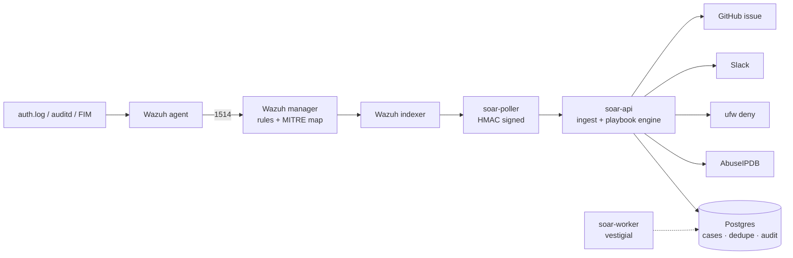

# soar-lab

A single-host SOAR lab: real SSH brute-force alerts from Wazuh, triaged and contained by a
versioned Python playbook with a full audit trail.

Built as a portfolio project to work through playbook lifecycle end to end — requirements,
design, testing, implementation, maintenance — on a $45/month budget.

**Status:** lab / MVP. Not production. See [Not built](#not-built).

---

## The problem

Tier-1 alert triage is repetitive, slow, and the part of the SOC people quit over. The usual
answer is a commercial SOAR platform, which is expensive and often ends up as a drawer full of
half-finished playbooks nobody maintains.

This is the opposite bet: a small, tested, auditable engine where the playbook is a text file
under version control, every action is idempotent, and a dry run exercises the whole graph
before anything touches production.

## Architecture



`soar-api` runs with `pid: host` and `privileged: true` so `nsenter` reaches the host firewall
namespace rather than a container's. Containment targets the host, not the stack.

## Quickstart

Full build runbook: [`docs/BUILD.md`](docs/BUILD.md). Roughly 4–6 hours from a clean Ubuntu
24.04 host.

```bash
cp .env.example .env      # fill in the API credentials
make up                   # SIEM + SOAR, all in Compose
make smoke                # signed alert through the whole pipeline, dry run
```

## How a playbook looks

Playbooks are YAML, validated against a schema, and versioned with semver. Steps reference
connectors by `namespace.action` and templates resolve from declared inputs.

```yaml
id: pb-001-ssh-bruteforce
version: 1.2.0
trigger: {source: wazuh, rule_ids: [100100, 100102], threshold: 5, window_seconds: 60}
inputs: [src_ip]
steps:
  - id: dedupe
    uses: state.dedupe
    with: {key: "{{ inputs.src_ip }}", ttl: 3600}
  - id: enrich
    uses: ti.abuseipdb
    with: {ip: "{{ inputs.src_ip }}"}
  - id: contain
    uses: contain.ufw
    on_error: continue
    with: {ip: "{{ inputs.src_ip }}", ttl_hours: 24, safe_ips: "{{ safe_ips }}"}
```

Adding a connector is one module exposing `async def run(**kwargs)`; the registry resolves it by
name and a parametrised test fails the build if a playbook references a connector that doesn't
exist.

## Playbooks

| ID | Playbook | Detection | MITRE |
|---|---|---|---|
| pb-001 | SSH brute force → enrich → contain → notify → ticket | 5 auth failures / 60s | T1110 |

Planned: impossible-travel for service accounts, PII exfil detection, IOC feed matching, red
team finding → remediation ticket.

## Design decisions

**The worker is vestigial.** `soar-worker` runs a uvicorn on 8081 that nothing calls; execution
happens in the API process via `asyncio.create_task` in the ingest handler. Recreate both
containers on any config change until the worker consumes the Redis queue the compose file
already provisions.

**Idempotency lives at intake, not in a step.** The `dedupe` step is documentation; the real
guard runs in `start()` before a case exists. Be aware the step never executes on a replay.

**A dry run walks the full graph.** Simulated enrichment deliberately returns a score above the
action threshold, because a dry run that skips the containment branch tests half a playbook.

**Threat intel confidence is not a gate.** Test and residential ranges score ~0 on AbuseIPDB, so
gating on score meant the playbook only fired for well-known attackers. The detection rule
already encodes volume; the score sets severity.

**Containment is allowlist-guarded inside the connector**, so the playbook can act
unconditionally and the admin IP is never blocked.

**Every step is audited** with resolved input, output and duration, append-only. That's the
evidence the automation is accountable rather than magic.

**Retries are bounded** — three attempts, exponential backoff with jitter, per-step timeout, and
`on_error: continue` on anything non-critical.

## Testing

```bash
make test
```

- Schema tests: bad connector names and unresolved template references are rejected
- Connector tests with recorded HTTP fixtures, so CI runs offline
- Retry test: a 502 then a 201, asserting the backoff path
- Registry test: every `uses` in every shipped playbook resolves to a real module
- Guard test: allowlisted IPs return `blocked: false`

## Metrics

`automation_ms` is the sum of every audited step duration in a run, in milliseconds. It
measures machine time only — it is **not** MTTR, which would also include analyst response.

Three run modes, and the figure depends entirely on which you sample:

| Mode | Typical `automation_ms` | Why |
|---|---|---|
| Dry run | ~28 ms | Every connector simulates; nothing is waited on |
| Live, all steps ok | ~1,100 ms | Real AbuseIPDB lookup, Slack POST, GitHub POST |
| Live, a step failed | ~4,500 ms | Three retry attempts with exponential backoff, then `on_error: continue` |

Representative figure for a successful live run: **~1.1 s**.

Note that a failure costs roughly 4× a success, because the backoff is doing the waiting rather
than the work. That's the argument for per-connector circuit breakers (see Roadmap) and for
excluding errored runs when reporting.

A high auto-close rate beside a high skip rate is the tell that a gate is misconfigured — the
run looks healthy while half the playbook never executes.

## Not built

- No unban automation — removing a deny rule is manual
- No case management UI; cases are Postgres rows
- `soar-worker` doesn't consume a queue yet; execution is in-process
- Single host, self-monitoring, no agent fleet
- Enterprise connectors (Splunk, CrowdStrike, Proofpoint) are mocked interfaces, not integrations
- No auth on the read endpoints; only ingest is HMAC-signed
- No RBAC, no multi-tenancy

## Roadmap

- Worker consumes Redis so the API only enqueues
- Playbook drift detection and a deprecation policy with real teeth
- Per-connector circuit breakers and rate limits
- Reusable connector SDK so adapters ship separately from the engine
- Second detection source on a separate host

## Layout

```
soar/app/engine/      DSL schema, loader, executor, retry, registry
soar/app/connectors/  one module per integration
soar/playbooks/       versioned YAML playbooks
soar/tests/           schema, connector and registry tests
docs/requirements/    stakeholder input and success criteria per playbook
docs/runbooks/        how to disable, unblock, escalate
docs/threat-model.md  blast radius per failure mode
docs/metrics-review.md weekly tuning log
docs/BUILD.md         full build runbook
```

## Licence

MIT
